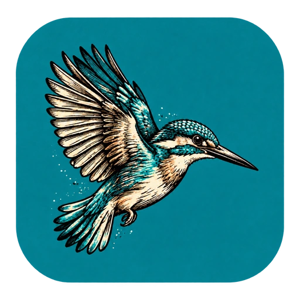
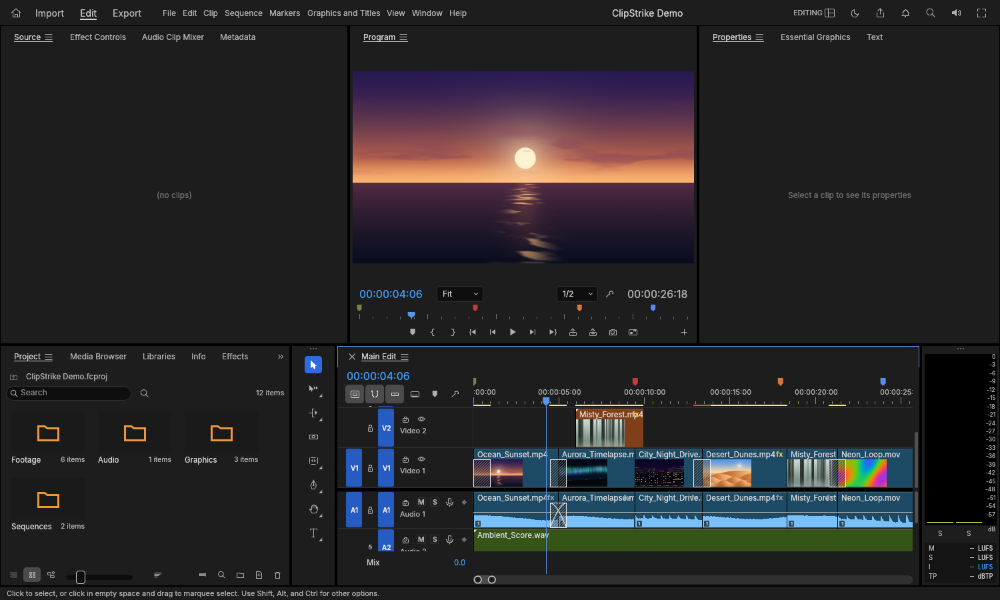

<p align="center">
  
</p>

<h1 align="center">FilmStrike</h1>

<p align="center">
  <a href="https://prowebdevsolutions.com"><picture>
    <source media="(prefers-color-scheme: dark)" srcset="assets/branding/PWDS-logo-orange.svg">
    
  </picture></a>
</p>

**Your footage. Your timeline.**

FilmStrike (formerly ClipStrike) is a desktop workspace for turning source footage into an edit. Organize media, review clips, build a cut across tracks, and save an editable project; its `.cstrike` importer reads capture packages without changing the originals.

## Name and compatibility

FilmStrike is the new display name; this is not a new project format or installation. Existing `.fcproj` projects, `.cstrike` imports, media paths, saved settings and recovery data remain unchanged. Build and launch using the existing `clipstrike` executable names below; a `filmstrike` executable is not introduced. The repository remains `Gerbzz/ClipStrike`. See [rename compatibility](docs/FILMSTRIKE_RENAME.md) for preserved identifiers.

## Rust direction and migration status

- **Target:** A Rust-native video editor, extending the selected FilmCraft foundation rather than restarting an already-Rust application.
- **Current implementation:** The [Cargo workspace](Cargo.toml) and [desktop entry point](apps/filmcraft/src/main.rs) are already Rust, with ClipStrike capture-import, safety and playback adaptations.
- **Remaining migration:** Continue adapting and validating the Rust editor. Native controls, playback and sound/picture sync, broader media fidelity and release packaging remain open; an existing Rust codebase is not a finished product.



This historical image shows the editor before the FilmStrike display rename and was captured from the public source using the app's own window screenshot command. Its built-in demo uses procedural media; no personal footage or match recording is included. See [screenshot provenance](docs/SCREENSHOT_PROVENANCE.md).

## Highlights

- Arrange video and audio on a multitrack timeline.
- Keep source media and project edits organized.
- Bring supported `.cstrike` capture packages into the editor.

## Current status

Windows editor candidate. This public source package built offline with a single Cargo job on Windows, and its procedural demo opened, saved as an editable project, rendered a full-window screenshot, and exited through the app's control interface. The separate `clipstrike-seek-next` preview has also had bounded local checks. The current package's test suite, native mouse and keyboard interaction, speaker output, and end-to-end sound/picture sync remain unverified; no release installer is provided.

## Edit a project

1. Bring source footage into the media pool and review it in the source viewer.
2. Place the parts you want on video and audio tracks, then save the editable project.
3. For a supported capture handoff, use the `.cstrike` importer. It reads the input conservatively and leaves the source project unchanged.

The current source checkout still needs hands-on playback review before these steps can serve as release instructions.

## Build the current desktop editor

Install Rust 1.95 or newer. From the repository root on Windows:

```powershell
cargo build --locked -j 1 -p filmcraft --bin clipstrike
cargo run --locked -p filmcraft --bin clipstrike -- --demo
```

The build can use `--offline` when the locked dependencies are already cached. `--demo` opens the source-generated media and timeline shown above; it needs no external footage. The app has no packaged installer at this checkpoint.

## Reproduce the bounded Windows checkpoint

With Rust 1.95 or newer, from the repository root:

```powershell
$env:CARGO_BUILD_JOBS = '1'
$env:CARGO_INCREMENTAL = '0'
cargo test --locked -p filmcraft-ui-egui --lib -- --quiet
cargo test --locked -p filmcraft-ui-egui --test source_playback_ui -- --quiet
cargo test --locked -p filmcraft --bin clipstrike-seek-next --features seek-checkpoint -- --quiet
cargo build --locked -p filmcraft --bin clipstrike-seek-next --features seek-checkpoint
```

The original migration checkout passed 132 UI, 10 source-viewer and 48 app tests, built `clipstrike-seek-next.exe` at SHA-256 `80c85828719378c5bd7d1babd4933fddc9b86f43ef5f320b26b6289b7e1ec16d`, and passed a bounded real-project live-seek trace. Independent review reproduced importer refusals and seek/pause progression. This selected source package has a newly synthetic importer fixture and a reduced workspace lockfile. Its **desktop app built successfully**, but its own test suite remains pending.

Native mouse/keyboard and accessibility use, speaker output and end-to-end sound/picture sync remain unverified. The current preview checkpoint is not a release or general media-fidelity claim.

See [SOURCE_SCOPE.md](SOURCE_SCOPE.md) for exact source and licensing boundaries and [ATTRIBUTION.md](ATTRIBUTION.md) for bundled donor assets. No first-party ClipStrike license grant is made by the donor license files.

## Next steps

Run the exact source package's test suite, then verify native controls, speaker output, and sound/picture sync with reviewed footage before packaging a release.

## Source history and credits

This editor candidate retains FilmCraft's editor, engine, timeline, media pool, project model, codec, and export UI, with ClipStrike importer, branding, safety, and playback changes. It descends from the earlier ClipStrike main at `fdf2f6ac8828374b803577ae1f6b310b73860075`, which DemoStrike still pins. See [SOURCE_SCOPE.md](SOURCE_SCOPE.md) for the exact source and license boundary and [ATTRIBUTION.md](ATTRIBUTION.md) for bundled donor assets. Donor license files do not grant terms for all first-party ClipStrike changes.

## PWDS brand artwork

The company mark in this masthead is the existing [official PWDS logo](https://github.com/Gerbzz/PWDS-Website/blob/main/public/prowebdevsolutions-logo.png), with the [official orange display asset](https://prowebdevsolutions.com/images/prowebdevsolutions-logo-orange.svg) for dark backgrounds. Any app logo above it remains the original Strike suite artwork.
